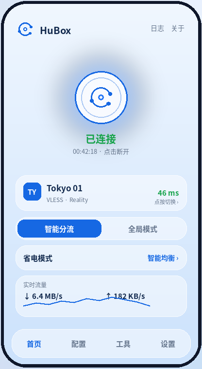

# HuBox for Android

  <strong>简洁、轻量的 Android 代理客户端 · 全新玻璃蓝白界面</strong> 
  基于 sing-box 内核，采用玻璃质感界面、底部导航与可定制主界面。

  
  
  
  

**HuBox** 是一款基于 [sing-box](https://github.com/SagerNet/sing-box) 内核的 Android 代理客户端，注重简洁的操作体验、清晰的信息呈现与灵活的代理配置。

## 界面预览

  

更多界面：[首页与深色模式](docs/images/home_sheet.png) · [节点选择层](docs/images/picker.png) · [配置页](docs/images/config.png) · [工具页与设置页](docs/images/tools_settings.png) · [主界面定制](docs/images/customize.png)

> 上图为设计预览图，实际界面以发布版本为准。

## 功能特点

- **代理管理**：管理节点与订阅，支持常用代理模式切换。
- **智能分流**：按应用、域名与 IP 自动区分国内外流量，可选国家/地区；用户自定义路由与 DNS 规则优先于智能兜底规则。
- **规则与分流**：围绕 sing-box 内核提供规则配置和流量分流能力。
- **连接与流量信息**：在应用内查看连接状态及实时流量统计。
- **电池优化选项**：省电模式提供性能优先、智能均衡和极限省电三档，调整部分后台统计轮询频率；实际耗电表现会因设备、系统和使用场景而异。
- **局域网共享**：免 Root 通过手机热点或局域网 Wi-Fi 把代理共享给其他设备（入口在工具页）。
- **WebView 安全**：HTTPS 仪表盘禁止加载不安全的混合内容；不会自动向第三方仪表盘发送本地 API 密钥。
- **WebDAV 备份**：仅允许 HTTPS 连接，避免 Basic Auth 凭据通过明文 HTTP 传输。

> 支持的协议、配置格式和具体行为以当前版本内置的 sing-box 内核及应用实现为准。

## 下载与安装

前往 **[GitHub Releases](https://github.com/smallmu1022-pixel/HuBoxForAndroid/releases)** 下载正式版 APK。

1. 下载与设备架构相匹配的 APK（如发布页面提供多个变体）。
2. 按 Android 系统提示允许本次安装来源安装应用。
3. 安装后导入自己的节点或订阅，并根据需要配置代理模式。

请仅从本仓库的 Releases 页面获取官方构建。安装前请确认 APK 来源与版本。

## 安全与备份说明

- Android 云备份不会包含应用数据库；设备迁移会保留配置/节点数据，但不会迁移保存 WebDAV 凭据与 Clash API 密钥的配置数据库。
- 手动导出或分享若包含节点配置，可能包含节点密码和订阅链接；若包含设置，可能包含 WebDAV 凭据与 Clash API 密钥。WebDAV 备份会自动包含配置和设置。请将这些备份视为敏感数据，仅保存或传输到可信位置。
- WebDAV 地址必须使用 HTTPS。第三方仪表盘不会再自动获得本地 API 密钥；如需手动配置，请先确认你信任该仪表盘的来源。
- 应用默认阻止非回环地址的明文 HTTP 连接；使用自定义 HTTP 仪表盘或服务器时，可能需要改用 HTTPS。

## 问题反馈与安全报告

- 使用问题与功能建议：请通过本仓库的 [Issues](https://github.com/smallmu1022-pixel/HuBoxForAndroid/issues) 提交，并尽量附上应用版本、Android 版本、复现步骤和相关日志。
- 安全问题：请优先阅读 [SECURITY.md](SECURITY.md) 中的报告指引；不要在公开 Issue 中发布密码、订阅链接、访问令牌或其他敏感信息。

## 开源协议

本项目以 **GNU General Public License v3.0（GPL-3.0）** 发布，详见 [LICENSE](LICENSE)。
